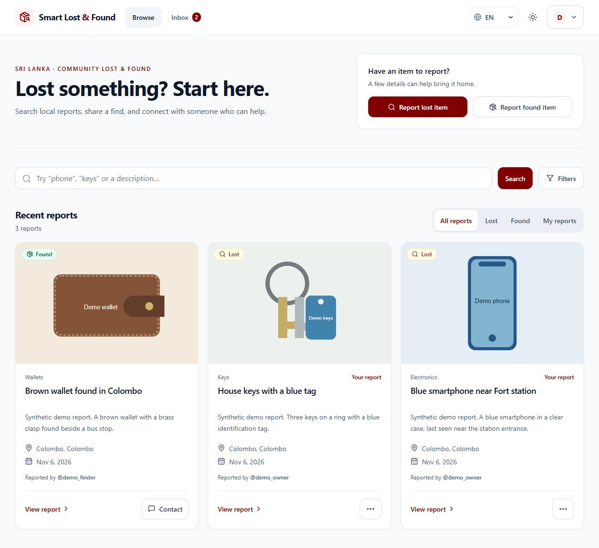

# Sri Lanka Smart Lost & Found

A web application for reporting lost and found items in Sri Lanka and coordinating their return. It includes English, Sinhala, and Tamil interfaces, location filtering, maps, real-time chat, and ownership verification workflows.

## Demo and engineering walkthrough



[Watch the 42-second walkthrough](docs/media/demo-walkthrough.mp4) · [Run the isolated demo](docs/DEMO.md) · [Architecture and engineering decisions](docs/ENGINEERING.md) · [UI decisions and browser checks](docs/UI_REVIEW.md)

The walkthrough uses synthetic data and predates the current visual redesign. The engineering focus is server-enforced conversation access, private ownership checks, retry-safe return rewards, and reproducible tests. See the engineering notes for evidence and remaining limitations.

## Project status

This project is under active development. The source includes AI-assisted image and voice reporting, QR tags, police and admin workflows, handover PDFs, analytics, and reward tips. External integrations require their own configuration.

Finder payouts are currently simulated, including when Stripe checkout is configured. This project should not be presented as a completed production payment system.

## Stack and structure

- `client/`: React, TypeScript, Vite, Tailwind CSS, and Leaflet. Pages are grouped by feature under `src/features/`.
- `server/`: Express, MongoDB/Mongoose, and Socket.IO. Routes call controllers; services contain matching, AI, payment, and document generation logic.
- `.github/`: CI workflow and contribution templates.

The browser calls the Express API and connects to Socket.IO for chat. MongoDB stores users, reports, conversations, and return records. Cloudinary stores uploaded images; Gemini powers image and voice analysis.

## Local development

### Prerequisites

- Node.js 24 and npm. `.nvmrc` records the version used in CI.
- A local MongoDB instance or a separate development database.
- Cloudinary credentials for image uploads. Gemini and Google OAuth credentials are needed only to exercise those integrations.

### Install and configure

From the repository root:

```sh
npm ci --prefix client
npm ci --prefix server
```

Copy `server/.env.example` to `server/.env` and `client/.env.example` to `client/.env`, using your editor or file manager. Set a unique `JWT_SECRET` and your development `MONGO_URI`. Keep credentials out of Git.

The examples use API port `5001` and frontend port `5173`. If you change a port, update `PORT`, `CLIENT_URL`, and `VITE_API_URL` consistently. For Google sign-in, use the same OAuth client ID in the server's `GOOGLE_CLIENT_ID` and the client's `VITE_GOOGLE_CLIENT_ID`.

All `VITE_` values are included in browser code: only public configuration belongs there. Never place a private API key in a `VITE_` variable.

Start the server and frontend in separate terminals:

```sh
cd server
npm run dev
```

```sh
cd client
npm run dev
```

Open the local URL printed by Vite. Optional integrations can be left unconfigured while working on unrelated features; their functionality will remain unavailable or use documented development behavior.

## Checks

From the repository root:

```sh
npm run build --prefix client
node client/node_modules/@playwright/test/cli.js install --only-shell chromium
npm test --prefix client
npm run test:recovery --prefix client
npm run check:syntax --prefix server
npm test --prefix server
```

The browser install is needed once per Playwright version. To use an installed copy of Chrome, set `PLAYWRIGHT_CHANNEL=chrome` in your environment. The default browser suite starts Vite on `127.0.0.1:4175` and uses synthetic API responses for sign-in and direct route navigation. The recovery suite uses real HTTP and Socket.IO with a disposable MongoDB replica set. Install the server dependencies before running it. It starts the frontend on port 4176 and the API on port 5004, both on loopback. The first run may download MongoDB 8.2.6. Neither browser suite needs live service credentials.

The client build runs TypeScript checking, creates a production bundle, and generates the PWA service worker. The server syntax command parses JavaScript without executing it. `npm test --prefix server` runs isolated tests for chat, security configuration, proof matching, ownership handlers, and seed configuration. `npm run test:integration --prefix server` starts disposable MongoDB replica sets and a loopback HTTP/Socket.IO server to test actual projections, response privacy, JWT validation, messaging authorization, concurrent awards, and rollback. Neither suite loads `.env` or uses `MONGO_URI`; integration tests may download MongoDB 8.2.6 on first use. CI runs both suites as separate jobs.

GitHub Actions runs these checks for pull requests and pushes to `main`. Passing them does **not** establish API correctness, integration availability, or production readiness. Frontend linting still needs an ESLint configuration; it is not part of the CI gate yet. Legacy scripts under `server/scripts/test_*.js` remain manual development scripts that may write to the configured database; `npm test` does not run them.

## Development seed scripts

Ownership identifiers (serial numbers, IMEIs, product/receipt codes, custom and unknown fields) require exact matches after Unicode normalization, outer-whitespace trimming, and case folding. Punctuation and internal whitespace remain significant. Approximate matching is limited to descriptive marks, special features, and engraving. Custom fields must match their label as well as their value. Verification accepts 1–20 non-empty, bounded string proofs and returns counts without returning private values.

Return completion and direct claims use a shared MongoDB transaction to update item status, return records, and karma together. Repeating the same completion succeeds without another award; competing return flows cannot both award points. MongoDB must run as a replica set (Atlas supports this); standalone local MongoDB does not support these transactions. Run `npm run test:integration --prefix server` to test retries, concurrent requests, and rollback against an automatically created disposable replica set. It never uses `MONGO_URI` or loads `.env`; the first run may download the pinned MongoDB 8.2.6 test binary.

Both `server/scripts/seed.js` and `server/scripts/seedPolice.js` require `MONGO_URI` in `server/.env` or the environment. They exit with an error before connecting if it is missing or blank. There is no embedded remote database fallback.

The item seed script deletes existing reports other than smart tags before creating sample data. Run it only against a disposable development database whose contents you intend to replace.

The police-account seed also requires `SEED_POLICE_PASSWORD`. It creates `national_police` with the supplied password after hashing it; an existing account is left unchanged. Set this value locally and run the script from the `server` directory:

```sh
node scripts/seedPolice.js
```

Changing this setting does not reset an existing account's password. Previously exposed database credentials and the previous default police-account password must be rotated separately if they are still in use. Removing them from source does not invalidate them or remove them from Git history.

## Frontend deployments

Production startup requires a unique `JWT_SECRET` of at least 32 characters and `CLIENT_URL` containing the primary frontend origin. Optional `CLIENT_ORIGINS` contains additional exact origins separated by commas. Configure both in Render before deploying authentication hardening. Changing the signing secret invalidates existing login tokens. Localhost origins are automatically allowed only outside production. CORS is applied to HTTP and WebSocket handshakes; authenticated chat operations also enforce item-creator participation on the server.

`client/vercel.json` enables automatic Git deployments only for `main`. Feature-branch pushes and pull requests still run GitHub CI, but do not automatically create Vercel previews when their branch contains this configuration. The `**` pattern covers branch names containing slashes; the explicit `main: true` rule enables main because Vercel deploys when any matching rule is true.

Use local development for routine changes. When a hosted preview is needed for UI review, request an intentional manual deployment through Vercel rather than enabling previews for every commit. Git deployment rules do not disable manual deployments. Branches created before this policy must first incorporate it to suppress their automatic previews.

Keep the Vercel project's Root Directory set to `client` and its production branch set to `main`. GitHub status checks are configured separately in `.github/workflows/ci.yml`; deployment is not a substitute for those checks. This policy does not make production deployment wait for CI to finish, and merging a docs-only or backend-only change into main can still trigger a frontend deployment.

See [Vercel Git configuration](https://vercel.com/docs/project-configuration/git-configuration) for branch-pattern behavior.

## Contributing

Read [CONTRIBUTING.md](CONTRIBUTING.md) for branch naming, PR examples, testing expectations, and review guidance. The workflow follows [GitHub flow](https://docs.github.com/en/get-started/using-github/github-flow); the CI setup uses GitHub's [Node.js workflow guidance](https://docs.github.com/en/actions/tutorials/build-and-test-code/nodejs).
