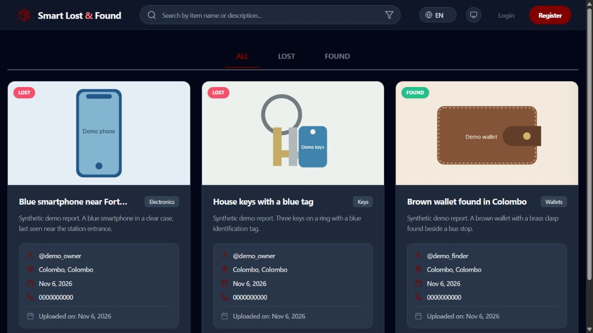
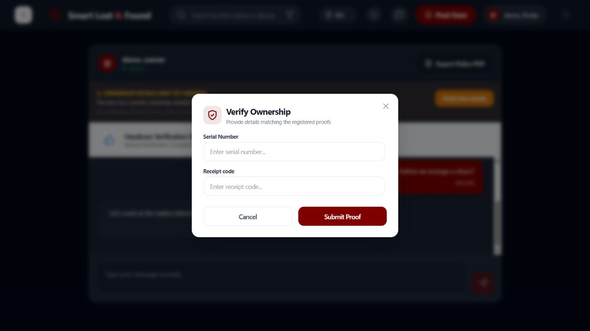
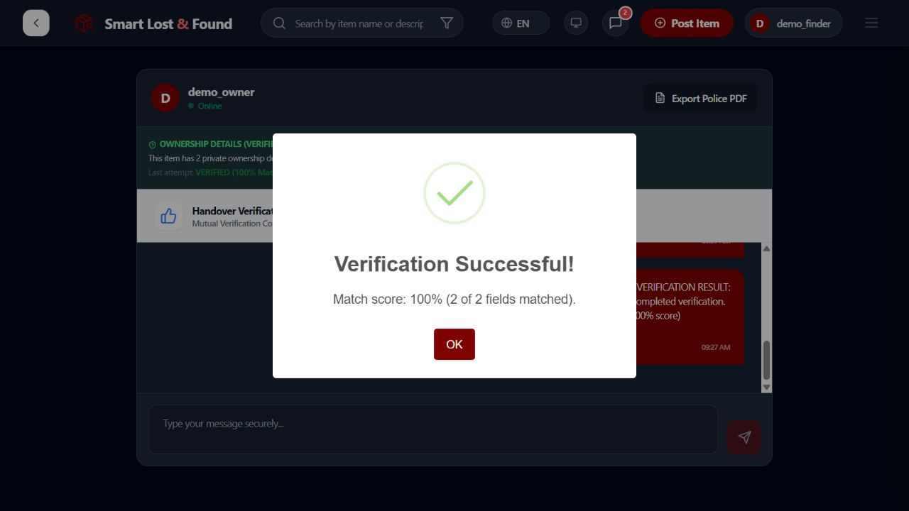
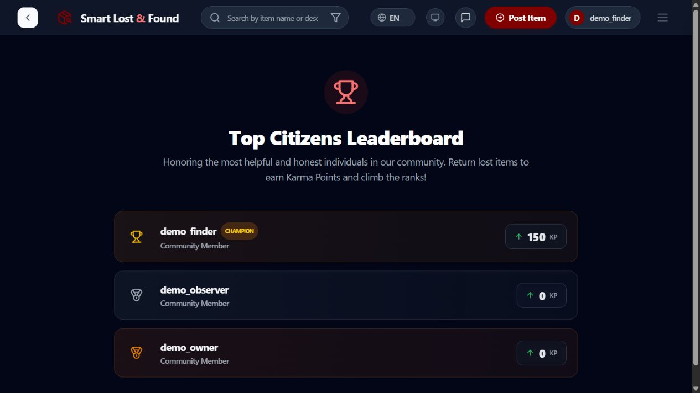

# Reproduce the demo

This walkthrough uses synthetic reports, public demo credentials, and an automatically created local MongoDB replica set. It never loads `server/.env` or uses the database configured in `MONGO_URI`. Restarting the demo starts fresh data. Do not publish these demo credentials as accounts on a real service.

## Run locally

Install the client and server dependencies with `npm ci --prefix client` and `npm ci --prefix server`, then run these in separate terminals from the repository root:

```sh
npm run demo --prefix server
```

```sh
npm run demo --prefix client
```

Open <http://localhost:5175>. The API uses port 5003. Stop both terminals with Ctrl+C when finished. The first server run may download MongoDB 8.2.6; it requires local process and loopback socket access. Uploaded media, AI, OAuth, and payment integrations are not configured in this demo. The images are local SVG illustrations of synthetic items.

Sign in with `demo_owner`, `demo_finder`, or `demo_observer`. Each uses the demo-only password `LearnWithDemo2027!`. The phone's serial number is `DEMO-4829`, and its custom receipt code is `DEMO-RECEIPT-42`.

## Two-minute interview walkthrough

Start with a fresh demo. Open the [finder chat](http://localhost:5175/chat/000000000000000000000101/000000000000000000000001) and [owner chat](http://localhost:5175/chat/000000000000000000000101/000000000000000000000002) in separate browser profiles so each keeps its own sign-in.

1. **Show proof privacy.** In the finder chat, open **Verify item details**. Point out that the form displays field labels without revealing the saved answers. Enter the exact demo serial and receipt values to show a successful match.
2. **Complete the return.** In the owner chat, choose **I received my item** and confirm. The finder starts at 100 karma and finishes at 150. The demo starts with mutual confirmation already recorded.
3. **Show the retry guarantee.** Run `npm run demo:check --prefix server` after the UI confirmation. It sends 12 concurrent receipt confirmations and should report **0 additional points**. On a fresh demo where the return is still open, the same command awards 50 points total.

Trace the receipt request through the [handover controller](../server/presentation/controllers/handover.controller.js), [return service](../server/business/services/return.service.js), and [return repository](../server/data-access/repositories/return.repository.js). The service returns an already completed record on retry. The repository uses the same MongoDB transaction for the item status, return record, and karma update. The [return integration tests](../server/tests/integration/returns.test.js) cover concurrent requests and rollback when the finder is missing.

## Five-minute walkthrough

1. Browse the dashboard and use the LOST/FOUND filters. Explain location and category filtering without claiming a measured national deployment.
2. Sign in as `demo_finder`. Open <http://localhost:5175/chat/000000000000000000000101/000000000000000000000001>. Exchange a message with the synthetic owner; a third account cannot join that pair's room.
3. Choose **Verify item details**. Submit `DEMO-4828` and `DEMO-RECEIPT-41` to see a rejection. Repeat using the exact values above to see successful verification. Explain why fuzzy matching is inappropriate for serial numbers.
4. Sign in as `demo_owner` and open <http://localhost:5175/chat/000000000000000000000101/000000000000000000000002>. The fixture starts after mutual confirmation, so **I received my item** completes the return.
5. Open the leaderboard as the finder. The fixture begins with 100 points; completing this return awards 50 more. The three-document update is transactional.

Alternatively, with both demo processes running, run `npm run demo:check --prefix server`. This uses the real HTTP login, detail, verification, and receipt endpoints. Twelve concurrent receipt requests award 50 points on the first completion and zero additional points on a repeat run. It only contacts the hardcoded loopback demo URL.

## Captured evidence

For the current interface, see [UI decisions and browser checks](UI_REVIEW.md). The video below predates the visual redesign.

[Watch the 42-second screenshot walkthrough](media/demo-walkthrough.mp4). It is a silent, captioned sequence of actual browser screenshots, not a continuous screen recording. The receipt completion shown was triggered through the API smoke check, then verified in the browser. All screenshots use disposable local data.









The video can be rebuilt with FFmpeg from `docs/media/walkthrough.txt` and the caption file. The fixture's timestamps and generated IDs may vary on a new run; its explicitly assigned account and report IDs are fixed so the links remain valid.
