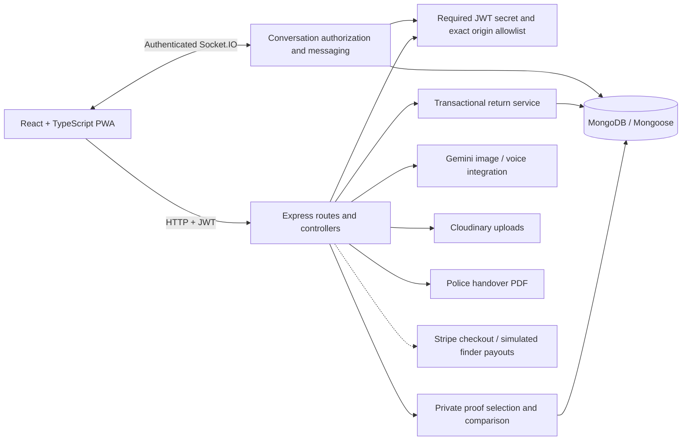
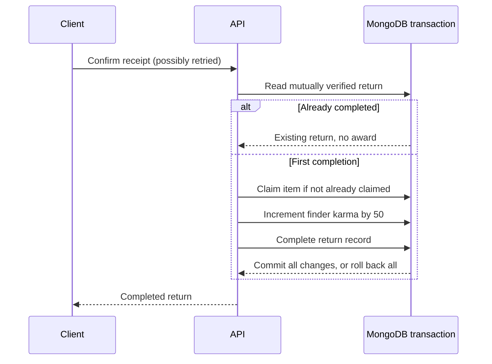

# Engineering decisions and evidence

The portal connects people reporting lost and found items with a workflow for private verification, conversation, and return confirmation. This document describes implemented behavior and the limits of the evidence, so reviewers can inspect the code and reproduce the tests.

## Architecture

The backend groups its three layers under `server/`:

- `presentation/` contains HTTP routes, controllers, middleware, and Socket.IO handlers. It validates request input and maps service outcomes to responses.
- `business/services/` contains use cases and business rules, including account administration, item recovery, conversation authorization, and tip processing.
- `data-access/` contains Mongoose models, repositories for queries and transactions, and adapters for external integrations.

`index.js` wires the layers together. Shared configuration, utilities, scripts, and tests sit alongside them. Runtime requests go through Presentation and Business Logic before reaching Data Access. The server test suite checks that presentation modules cannot import Data Access directly and that business services use repositories for database access.

Vercel hosts the frontend and Render runs the persistent Express/Socket.IO server. MongoDB Atlas provides the hosted database. Local demo and integration tests create separate replica sets. Optional external services are not required for the isolated recovery walkthrough.

## Authentication and conversation boundaries

A JWT establishes identity; it does not by itself grant access to a room. Room names are parsed and checked against the authenticated user, the other account, and the item's creator. Sending a message repeats authorization and derives its sender from the socket identity. The HTTP history endpoint enforces the same participant rule. Connections with expired tokens, deleted users, or unlisted WebSocket origins are rejected.

The server requires an explicit signing secret and an exact frontend origin allowlist. CORS alone is not access control: non-browser clients can omit Origin, so the API and socket handlers still authenticate and authorize actions. The frontend retains message text when acknowledgement fails; a timeout tells the user to inspect the conversation before retrying because a timeout does not prove that persistence failed.

## Ownership data

The item controller validates submitted proof fields and maps the verification result to HTTP. The ownership service scores proofs and records the outcome. The ownership repository explicitly selects the private proof values for that workflow. The HTTP route and Socket.IO handlers delegate to the chat service, which shares one conversation authorization rule and uses the chat repository for message queries.

Mongoose excludes proof values from ordinary queries. The verification handler explicitly selects them for comparison; the item-detail handler selects them to expose field labels and strips values for non-creators. Serial numbers and other identifiers use exact comparisons after documented normalization. Descriptive matching remains approximate and is not legal proof of ownership. Human confirmation still governs the physical return.

The earlier schema declared `ownershipProofs` twice, so JavaScript overwrote the first declaration. Consolidating it preserved privacy defaults and restored custom-label persistence. Both UI callers now send `submittedProofs` and consume the same result fields.

Existing custom proofs whose labels were discarded by the old schema need an owner update; consolidation cannot reconstruct lost labels.

## Return consistency

Receipt confirmation crosses three backend layers. The **Presentation** layer authenticates and authorizes the conversation in `handover.routes.js` and maps the result to HTTP in `handover.controller.js`. The **Business Logic** layer in `return.service.js` determines who can confirm receipt, checks the return state, and decides when to award karma. The **Data Access** layer in `return.repository.js` runs Mongoose operations and binds them to the same transaction. Direct claims use the same transaction boundary.

The item document is the shared contention point across direct claims and multiple candidate handovers. Transactions prevent a crash between item, record, and karma updates from leaving a partial success. Retries return an existing completed record, while a competing completed flow produces a conflict. This requires a replica set. Existing data is not rewritten, and historical duplicate awards are not automatically corrected.

## Validation

- 33 isolated tests cover layer imports, configuration, chat handlers, input shape, proof matching, response privacy, and seed-script configuration.
- 25 integration tests use disposable MongoDB replica sets, HTTP requests, and Socket.IO connections. They cover account and admin access, reports and hotspots, messaging and notifications, handovers and PDF downloads, tip history, and transactional return retries and rollback.
- The browser walkthrough verifies message acknowledgement, rejects near-matching identifiers, accepts exact details, and displays completed returns and the awarded score.
- `npm run demo:check --prefix server` runs real HTTP smoke checks against a local synthetic fixture. Repeating it after completion awards zero further points.
- TypeScript/Vite/PWA builds and JavaScript parsing are separate checks. They complement behavioral tests rather than replace them.

## Practical limits and next work

Finder payouts are simulated. No production traffic, recovery-rate improvement, load-test capacity, or security certification is claimed. The test database is MongoDB 8.2.6; deployments should verify compatibility with their configured Atlas version. Tests do not exercise live Gemini, Google OAuth, Cloudinary, payment processing, or real police systems.

Rate limiting and abuse prevention, a working frontend ESLint gate, dependency-vulnerability remediation, multi-instance socket delivery, and accessibility testing remain follow-up work. Tokens are still stored in localStorage; evaluating cookie-based sessions would require an explicit design and CSRF strategy. The repository contains contributions from several people; commit and PR history should be used to distinguish individual contributions.

## Interview discussion prompts

Selected merged PRs: [contribution workflow and CI (#61)](https://github.com/minuraDinupriya/smart-lost-and-found-sl/pull/61), [explicit seed credentials (#62)](https://github.com/minuraDinupriya/smart-lost-and-found-sl/pull/62), [deployment policy (#63)](https://github.com/minuraDinupriya/smart-lost-and-found-sl/pull/63), and [private proof loading (#64)](https://github.com/minuraDinupriya/smart-lost-and-found-sl/pull/64). The [recovery hardening batch](https://github.com/minuraDinupriya/smart-lost-and-found-sl/compare/main...feat/recovery-workflow-hardening) is proposed work until reviewed and merged.

- Reproduce the original private-field projection bug and explain why making the field public would be the wrong fix.
- Explain the difference between JWT authentication, room authorization, and browser CORS enforcement.
- Walk through two concurrent receipt requests and the transaction's shared contention point.
- Explain a test double versus a real database test, and why neither tests an unconfigured external provider.
- Discuss what an acknowledgement timeout means and why the UI preserves a draft.
- Show one focused commit, its validation, and a tradeoff you can explain in your own words.
