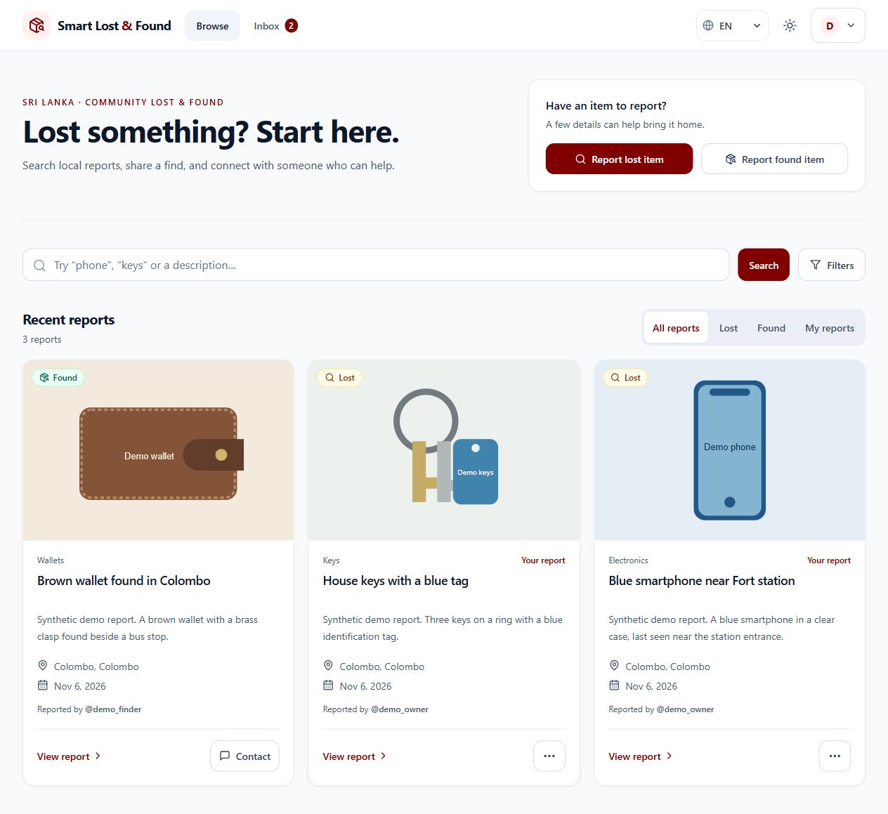
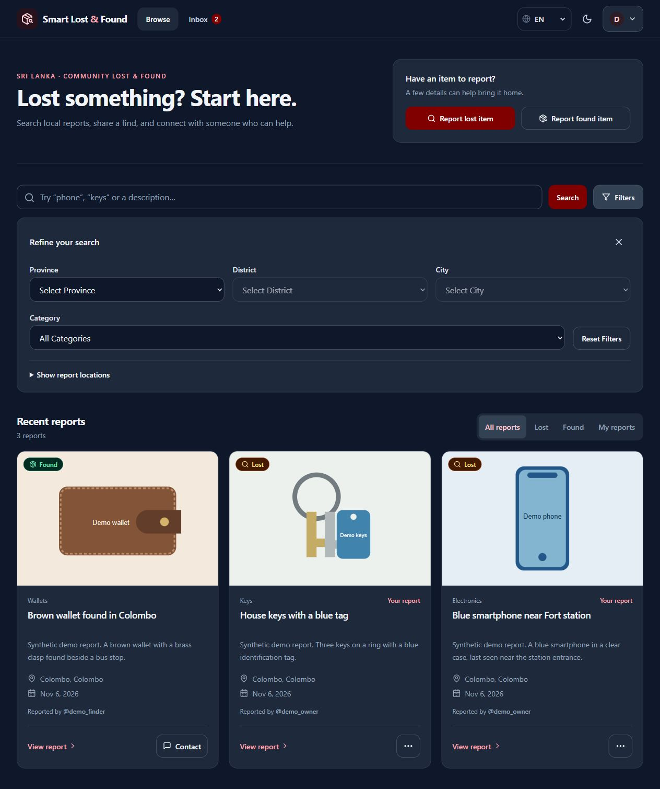
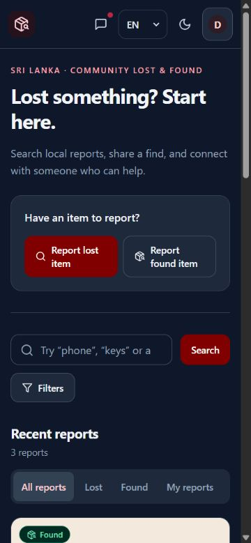
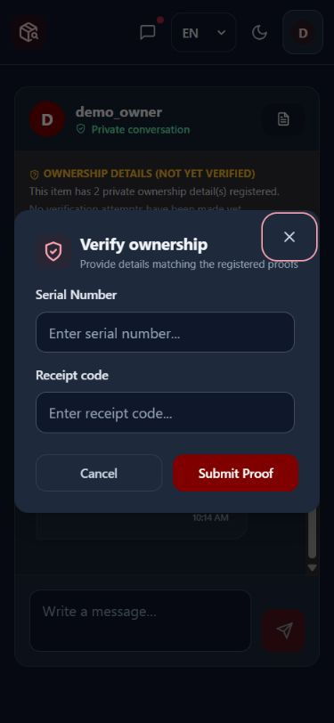

# UI consistency and recovery flow

The redesign prioritizes finding a report, reporting a lost/found item, and continuing a conversation. Secondary tools remain in the account menu. It keeps the existing maroon identity and uses slate surfaces; green and amber communicate status.

## Changes and decisions

- Shared Tailwind color tokens and panel, button, field, label, and status styles keep light and dark themes consistent.
- Search is visible on mobile. The homepage offers separate lost/found shortcuts, category/location filters, optional map expansion, loading skeletons, retry feedback, and clearer empty results.
- Cards show a photo, title, brief description, location, event date, and reporter. Phone numbers stay on the detail page. Owner actions move to a disclosure rather than competing with browsing.
- Navigation uses Browse, Inbox, and reporting actions, plus a keyboard-accessible account disclosure for other tools. Escape closes it and restores focus.
- Sign-in/registration share one form with visible labels, autocomplete, inline validation, error announcements, and pending states. Successful sign-in restores an internal destination, including the selected reporting intent.
- The reporting wizard labels its steps, validates before advancing, preserves location when going back, and keeps voice/photo assistance optional. Separate button keys prevent the next-step click from also activating the final submit button.
- Chat uses “Private conversation” rather than claiming a live presence signal. Return status, ownership verification, report details, account pages, and supporting screens receive theme fixes. The verification dialog uses the native modal dialog for keyboard behavior.
- Homepage, navigation, card, and authentication additions have English, Sinhala, and Tamil translations. Karma points, verification, and returns use consistent wording.
- A skip link, visible focus indicators, larger controls, and reduced-motion support cover the shared experience. Framer Motion also respects the user's reduced-motion setting.

## Validation

Commands run from the repository root:

```sh
npm run build --prefix client
npm run check:syntax --prefix server
npm test --prefix server
npm run test:integration --prefix server
```

The client production build passed, the syntax check parsed 60 server files, and the existing suites passed 32 unit/handler tests and 16 MongoDB/HTTP/Socket.IO integration tests.

Manual browser checks used only the disposable local demo described in [DEMO.md](DEMO.md):

- Desktop light/dark and 375px/320px mobile layouts. Sinhala and Tamil homepage layouts were checked at 320px; long Tamil text and card actions now wrap without horizontal overflow.
- Combined text/category filtering, filter reset, retained location after reopening filters, and map expansion with a nonzero map size.
- Account menu links, keyboard Escape, and focus returning to the trigger.
- Empty sign-in validation, registration password mismatch, invalid credentials, and successful synthetic sign-in returning to `/post?type=LOST`.
- Found-item shortcut, required details, location selection, back navigation, final-step behavior, pending publication, and successful creation of a synthetic report.
- Mobile dark chat, verification fields, Escape/focus restoration, and successful matching of the synthetic serial number and custom receipt. The detail-page proof selector also submitted the custom receipt correctly; its dialog no longer scrolls horizontally.

## Evidence

All images use synthetic local data.

Before: [previous dashboard](media/01-dashboard.jpg).







[Mobile homepage in light mode](media/ui-home-mobile-light.jpg)



## Limits and follow-up

- The checks above were manual. Playwright also covers sign-in, direct navigation to analytics and admin, and the full recovery flow against a disposable database. A formal accessibility audit remains open.
- Google OAuth, microphone recording, AI services, real payments, and role-specific admin/police operations were not exercised. Their existing integration/configuration requirements remain.
- Some older feature pages still use English-only text. This change does not claim complete localization of every existing feature.
- Analytics, admin, police, and smart-tag routes now load in separate chunks. The production entry bundle dropped from 413.47 kB to 279.71 kB gzipped (32%). This measures the entry JavaScript file. The service worker still precaches route chunks in the background. Vite still reports a large-bundle warning and stale Browserslist data. Frontend linting still requires the configuration noted in the README.
- The older screenshot walkthrough demonstrates the recovery logic and predates this visual redesign.

## Interview discussion

Explain the user problem, the shared styles and navigation decisions, and the concrete regressions caught during mobile testing. Distinguish manual checks from automated tests. Be ready to explain the code and describe AI assistance accurately.
